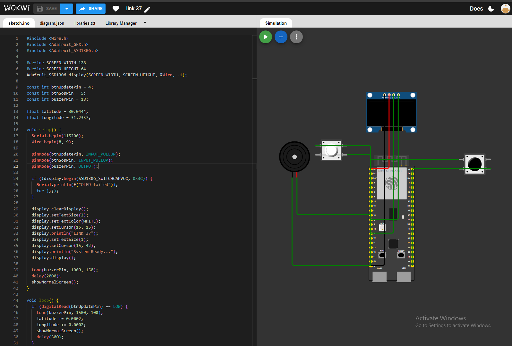

# Link 37 - Personal GPS Tracker & SOS Device

## Project Overview
Link 37 is a portable hardware tracker built with **ESP32-S3**, a **0.96" OLED Display**, **Ublox NEO-7M GPS module**, and emergency **SOS buttons**. It displays live coordinates and sends an audio/visual alert in emergencies.

## Hardware Components (BOM)
* ESP32-S3 Development Board
* 0.96 inch I2C OLED Display (SSD1306)
* Ublox NEO-7M GPS Module
* 2x Push Buttons (Update & SOS)
* Piezo Buzzer

## Wiring Diagram & Simulation

